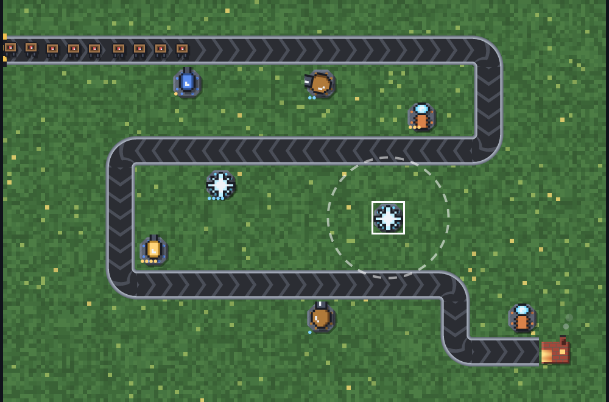

# factory

A pixel-art tower defense game for your terminal. It looks best in [Ghostty](https://ghostty.org).

Waves of scrap bots ride a conveyor toward your factory. Place towers along the conveyor, upgrade them along two paths, and clear 40 rounds to win. After that you can keep going in freeplay.

It's made to sit in a split next to your AI agents, and they can send you messages that show up in the game.



## Install

```bash
curl -fsSL https://raw.githubusercontent.com/thesnarkitecht/factory/main/install.sh | sh
```

This puts `factory` in `~/.local/bin` (set `FACTORY_BIN_DIR` to change that). It downloads a prebuilt binary for macOS or Linux. If there is none, it builds from source, fetching a temporary copy of Go if you do not have one (no sudo or Homebrew needed). To build from source yourself: `go install github.com/thesnarkitecht/factory@latest`.

## Ghostty native

- **Pixel graphics** through the Kitty graphics protocol, drawn at your screen's real pixel size, so sprites stay sharp on Retina displays. When you play locally, frames go through a temp file instead of the terminal stream.
- **Synchronized output** (mode 2026), so frames never tear.
- **Tab progress bar** (OSC 9;4) that shows your lives and turns red when they run low, and **desktop notifications** (OSC 9) when an agent messages you.
- **Mouse**: the cursor follows your pointer. Click to build or upgrade, and right-click to stop placing.

It works in other terminals too. At startup it asks the terminal what it supports. Kitty, and any other terminal that answers the graphics probe, gets the same pixel graphics. Everything else, including tmux, gets a truecolor half-block renderer. `factory --blocks` forces the half-block renderer.

## Playing

| Key | Does |
| --- | --- |
| arrows / wasd / mouse | move the cursor |
| `1`–`4` | pick a tower (press again to stop placing) |
| Space / click | build |
| `u` / `i` | upgrade the top / bottom path of the tower under the cursor |
| `x` | sell (75% back) |
| Enter | start the next round |
| `A` | auto-start rounds |
| `f` / `p` | fast-forward / pause |
| `?` / `q` | help / quit |

You can also click the rows in the sidebar.

Rounds start only when you press Enter, and clearing one pays a bonus. Killing bots pays too.

**Upgrades:** each tower has two upgrade paths of four tiers each. One path can reach tier 4, but then the other path stops at tier 2. The sidebar shows a tower's tiers as `2-1` and so on.

| Tower | Top path (`u`) | Bottom path (`i`) |
| --- | --- | --- |
| Gun turret $170 | Oiled Gears → Belt Feed → Twin Barrels → **Minigun** | Long Barrel → AP Rounds → Scope → **Railgun** |
| Cannon $350 | Bigger Shells → Heavy Shells → Cluster Shot → **Demolisher** | Fast Reload → Long Range → Stun Shells → **Shockwave** |
| Tesla coil $450 | More Coils → Chain Storm → Arc Reactor → **Overload** | Capacitor → Long Arc → Static Field → **Supercell** |
| Frost vent $240 | Deep Chill → Permafrost → Ice Shards → **Absolute Zero** | Wider Vent → Brittle → Cryo Burst → **Glacier** |

**Bots:**
- Scrap bots come in swarms.
- Bolts are fast.
- Brutes are tough.
- Hulks are armored, so gun bullets bounce off them until the gun has **AP Rounds**. Cannons, tesla coils and frost vents can always hurt them.

## Agent messages

Anything that can run a shell command can message you in the game:

```bash
factory msg --from my-agent "Tests fixed\n- 3 flaky tests"
echo "done" | factory msg
```

You can also drop a file into `~/.factory/inbox/`.

**Claude Code**: add these hooks to `~/.claude/settings.json`. You'll get the agent's last reply when it finishes, and a "needs you" message when it's waiting on you.

```json
{
  "hooks": {
    "Stop": [{ "hooks": [{ "type": "command", "command": "factory hook" }] }],
    "Notification": [{ "hooks": [{ "type": "command", "command": "factory hook" }] }]
  }
}
```

## Development

```bash
go run .          # play from source
go test ./...     # simulation, upgrade paths, armor, rounds, sprites, input parsing, hooks, and a rendered frame
FACTORY_PNG=/tmp/f.png go test -run RenderPNG   # look at a frame
```

- `td.go`: the rules: path, towers and their upgrade paths, bots, rounds and money. 20 ticks a second, no drawing.
- `sprites.go`: hand-drawn 16×16 pixel art. Edit the letters to redraw a unit.
- `render.go`: draws the sprites (rotated, anti-aliased, and cached for each tile size), the conveyors and the effects.
- `term.go`: input parsing, the terminal capability probe, Kitty graphics and the half-block renderer.
- `app.go`, `main.go`: the game loop, the UI panels and the CLI.

Releases: push a `v*` tag. CI then builds the macOS and Linux binaries that the install script downloads.
